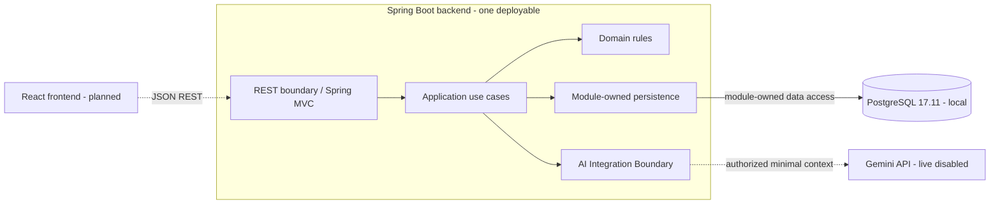

# SmartRent

**AI-integrated rental property management for landlords, property managers, and tenants.**

SmartRent brings rental records, maintenance workflows, and tenant communication into one system. Its approved design combines a modular Spring Boot backend, a React frontend, PostgreSQL, and Gemini assistance behind a backend-controlled AI boundary.

> **Development status:** C6-01/C6-03 are merged through PR #9/#10. The local backend-first working tree now implements B01–B15 (33 business REST routes) with PostgreSQL migrations V1–V9. Final local stabilization results and remaining release gates are in [backend completion evidence](docs/ai-evidence/backend-completion.md). These changes are committed locally on `feature/backend-completion`; hosted CI at this revision, live Gemini evaluation, frontend and deployment remain pending.

[Roadmap](docs/project-roadmap.md) · [Backend guide](backend/README.md) · [Implementation backlog](docs/chapter-06-ai-programming/implementation-backlog.md) · [API contracts](design/api/README.md)

## Contents

- [Overview](#overview)
- [Implementation status](#implementation-status)
- [Product capabilities](#product-capabilities)
- [Technology stack](#technology-stack)
- [Architecture](#architecture)
- [Repository structure](#repository-structure)
- [Getting started](#getting-started)
- [Environment configuration](#environment-configuration)
- [API overview](#api-overview)
- [Testing](#testing)
- [CI and deployment](#ci-and-deployment)
- [Security principles](#security-principles)
- [Roadmap](#roadmap)
- [Documentation](#documentation)
- [AI-assisted development](#ai-assisted-development)
- [Contributing](#contributing)
- [License and project ownership](#license-and-project-ownership)

## Overview

Rental operations involve linked information: properties and rooms, tenant profiles, contracts, rent records, and maintenance requests. SmartRent is designed to centralize that information and keep access tied to each user's role and relationship to a resource.

Landlords and property managers are the management users; tenants access their own rental information and requests. AI supports classification and information retrieval. It is an integration component, not an actor with independent permission to access data or change business state.

The backend now supports authentication, owner-scoped rental resources, billing, maintenance, notifications and read-only AI assistance. It can be exercised through HTTP tests and local API clients. Frontend implementation is deliberately deferred; live AI is disabled by default.

## Implementation status

The following distinguishes executable behavior from configuration and design intent.

| Area | Status | Evidence / next step |
|---|---|---|
| Requirements, UX, architecture and API designs | Documented; new product-policy details await named review gates | [Sprint 0 decisions](docs/sprint-0-decisions.md) |
| Backend foundation — C6-01 | Merged through [PR #9](https://github.com/aanhtuan/SmartRent/pull/9) | [Source](backend/src/main/java/com/smartrent/), [task evidence](docs/ai-evidence/c6-01-backend-foundation.md) |
| Backend build, context and HTTP checks | See final local verification evidence (2026-10-25); this revision has not run on hosted CI | [Tests](backend/src/test/java/com/smartrent/), [verification instructions](#testing) |
| Backend GitHub Actions | C6-01 and C6-03 hosted CI passed at their merged revisions | [Workflow](.github/workflows/backend-ci.yml) |
| Frontend — C6-02 | Deferred in the backend-first track; no frontend application or package manifest | [Backlog](docs/chapter-06-ai-programming/implementation-backlog.md) |
| Database infrastructure — C6-03 | Merged through [PR #10](https://github.com/aanhtuan/SmartRent/pull/10) — PostgreSQL, role separation and V1 users only | [Logical schema](design/database/schema.md) |
| Synthetic account provisioning — B01/C6-04 | Implemented and verified locally; disabled by default; commit/hosted CI pending | [B01 evidence](docs/ai-evidence/c6-04-dev-account-provisioning.md), [opt-in guide](backend/README.md#explicit-devtest-account-provisioning--b01c6-04) |
| JWT and rental business features | Implemented locally; release gates pending | [API contracts](design/api/README.md) |
| Gemini classification and Assistant | Adapter/preview/fallback/authorized context implemented; fake tests only, live evaluation NOT RUN | [AI boundary](design/architecture/smartrent-architecture.md) |
| Deployment / continuous delivery | Not configured or deployed | Current work targets local development |

Backend verification does not complete frontend/full-stack course gates. The PO authorized continuous backend implementation using the documented working baselines on 2026-10-25; this does not fabricate retroactive individual gate sign-offs.

## Product capabilities

These are implemented backend capabilities, grouped by user outcome; a user interface and live AI quality evaluation remain deferred.

| Capability | Intended experience |
|---|---|
| Property and occupancy management | Manage properties, rooms, tenant profiles and rental contracts within an authorized management scope. |
| Rent tracking | Create and view rent records and payment status; no banking integration or AI transaction confirmation. |
| Tenant self-service | View authorized rental information, submit maintenance requests and follow their status. |
| Maintenance operations | Review requests, manage permitted status transitions and notify relevant users. |
| AI-assisted maintenance | Preview category, priority, summary and missing information; retain explicit confirmation and manual fallback under the reviewed contract. |
| Rental information Assistant | Answer questions using only backend-authorized context and acknowledge missing information. |

See [requirements](docs/chapter-03-requirement-analysis/03-requirement-analysis.md), [user stories](docs/chapter-03-requirement-analysis/04-user-stories.md), and [feature specifications](docs/chapter-03-requirement-analysis/05-feature-specification.md). Ownership, lifecycle, billing and AI defaults require the review gates in the [decision register](docs/sprint-0-decisions.md).

## Technology stack

Versions are shown only where pinned or resolved in the current increment. Planned components have no selected version yet.

| Layer | Approved technology | Current adoption |
|---|---|---|
| Frontend | React, TypeScript, Vite, Tailwind CSS | Planned |
| Backend | Java 21, Spring Boot **3.5.16**, Spring MVC | Implemented backend; [Maven configuration](backend/pom.xml) |
| Security | Spring Security **6.5.11**, JWT | RS256 JWT, 30-minute TTL, Argon2id and backend authorization |
| Persistence | PostgreSQL, Spring Data JPA, Hibernate, Flyway | PostgreSQL 17.11, Hibernate 6.6.53.Final, JDBC 42.7.14, Flyway 11.7.2; nine forward migrations |
| Application AI | Gemini API through a backend AI Adapter | v1beta generateContent / pinned working-baseline model gemini-3.8-flash; live disabled |
| Backend testing | JUnit Jupiter **5.12.2**, Mockito **5.17.0**, Testcontainers | JUnit/Mockito supplied by Boot; Testcontainers 1.21.4 PostgreSQL tests implemented |
| Frontend/E2E testing | Vitest, Playwright | Planned |
| Build | Maven **3.9.16**, Maven Wrapper **3.3.4** | Pinned wrapper; global Maven not required |
| Infrastructure | Docker Compose, GitHub Actions | Local PostgreSQL Compose implemented; backend Actions configured |

The pinned Spring Boot parent manages transitive dependencies, with documented compatible security patch overrides for Tomcat, Jackson, JDBC and Log4j. See the [backend toolchain guide](backend/README.md#toolchain-and-dependencies) for version selection and upstream sources.

## Architecture

SmartRent uses **Modular Monolith + Layered Architecture + REST API + PostgreSQL + AI Integration Boundary**. The backend is one deployable application with feature modules. Spring MVC handles HTTP requests; it does not turn those modules into separate services.

The diagram shows the implemented backend and deferred external surfaces. The frontend and live Gemini connection are not running as part of automated verification.



Features are grouped under `identity`, `property`, `room`, `tenant`, `contract`, `payment`, `maintenance`, `notification`, `assistant` and `aiintegration`. Each uses `api`, `application`, `domain` and `persistence` boundaries. Controllers call application services; provider access and database writes remain separated.

Controllers delegate to application use cases. Domain rules remain independent of HTTP and provider SDKs; persistence adapters stay module-owned. Cross-module work uses public application interfaces or in-process events. Only the backend AI Adapter may call Gemini. Detailed models are in [Chapter 5](docs/chapter-05-software-architecture/01-architecture-design.md) and [architecture artifacts](design/architecture/README.md).

## Repository structure

```text
SmartRent/
├── README.md
├── AGENTS.md                          # shared development-agent rules
├── .agents/skills/                    # repository and upstream skills
├── .gemini/settings.json              # Gemini workspace context
├── .github/workflows/backend-ci.yml   # local backend CI definition
├── compose.yaml                       # localhost PostgreSQL / named volume
├── .env.example                       # placeholders; local .env is ignored
├── infra/postgres/                    # empty-volume role bootstrap
├── backend/
│   ├── pom.xml
│   ├── mvnw, mvnw.cmd
│   ├── .mvn/wrapper/
│   ├── src/main/java/com/smartrent/    # bootstrap and feature/layer packages
│   ├── src/main/resources/            # safe application defaults
│   ├── src/test/java/com/smartrent/    # context, HTTP and config tests
│   └── README.md                      # backend-specific instructions
├── docs/
│   ├── project-roadmap.md
│   ├── sprint-0-decisions.md
│   ├── implementation-readiness.md
│   ├── chapter-03-requirement-analysis/
│   ├── chapter-04-product-design/
│   ├── chapter-05-software-architecture/
│   ├── chapter-06-ai-programming/
│   ├── chapter-07-code-review-refactoring/
│   ├── chapter-08-software-testing/
│   ├── chapter-09-technical-documentation/
│   └── ai-evidence/
├── design/                            # API, architecture, schema, UML and UX
├── prompts/                           # Chapter 3–5 prompt templates
├── demo/                              # Chapter 3–5 design/demo specifications
└── skills-lock.json                   # upstream skill source metadata
```

`backend/target/` contains ignored, regenerable build output. Local `.env` and `.local/` toolchain/cache files are ignored. Frontend implementation remains planned.

## Getting started

### Prerequisites

- A checkout of `main` containing merged C6-01 and C6-03. Database-free C6-01 startup instructions belong to its earlier revision.
- **JDK 21**, active on `PATH`, with `JAVA_HOME` pointing to the same JDK when set. Java 25 is not the project's build runtime; Maven Enforcer rejects incompatible major versions.
- A POSIX shell for the commands below and `curl` for health checks. The wrapper needs Java and download/extraction tools on first use; see [wrapper requirements](backend/README.md).
- Docker with an accessible daemon and Docker Compose; network access to Maven Central and Docker Hub for initial downloads. No global Maven, frontend tooling or Gemini key is required.

Use your installed JDK/toolchain manager to activate Java 21 before continuing. JDK paths are machine-specific; temporary paths from development sessions are not project configuration.

### Build and start the backend

From the repository root, copy the template **only if `.env` does not exist**, then set three distinct local passwords. Never overwrite existing credentials or volume data:

```sh
cp .env.example .env
chmod 600 .env
```

Edit `.env` before continuing. Configure the three database-role passwords and matching external RSA key file paths; see the [key setup and safety instructions](backend/README.md#local-database-and-normal-application-startup). With these configured:

```sh
docker compose config --quiet
docker compose up -d --wait
docker compose ps
. ./.env
export DB_URL DB_USERNAME DB_PASSWORD DB_MIGRATION_USERNAME DB_MIGRATION_PASSWORD
export SMARTRENT_JWT_PRIVATE_KEY_FILE SMARTRENT_JWT_PUBLIC_KEY_FILE
export SMARTRENT_JWT_ISSUER SMARTRENT_JWT_AUDIENCE SMARTRENT_CORS_ORIGINS
cd backend
java -version
./mvnw --version
./mvnw --batch-mode --no-transfer-progress verify
java -jar target/smartrent-backend-0.0.1-SNAPSHOT.jar
```

The first two commands must report Java 21 and Maven 3.9.16. `verify` runs tests and creates the executable JAR. Startup is complete when the log reports `Started SmartRentApplication` and Tomcat listening on port 8080; the Spring Boot banner alone is not a readiness check.

In another terminal:

```sh
curl --fail --silent --show-error http://127.0.0.1:8080/actuator/health
```

Expected response:

```json
{"status":"UP"}
```

The listener defaults to `127.0.0.1:8080`. Stop the foreground process with **Ctrl+C**. If port 8080 is already in use, select another local port:

```sh
SERVER_PORT=8081 java -jar target/smartrent-backend-0.0.1-SNAPSHOT.jar
```

In another terminal, check the selected port:

```sh
curl --fail --silent --show-error http://127.0.0.1:8081/actuator/health
```

Health reports process/database status; it does not certify provider quality, the complete backend acceptance suite or deployment readiness.

### Frontend and database

Frontend setup remains planned under C6-02. Normal startup runs the forward Flyway migrations; the current working tree adds rental tables after the preserved V1. The retained local database has not been migrated by this task. See the [backend guide](backend/README.md) for role permissions, repeat startup, volume safety and verification.

## Environment configuration

| Variable | Default | Purpose |
|---|---|---|
| `JAVA_HOME` | Java discovery through `PATH` if unset | Select a JDK 21 installation for the wrapper; keep `PATH` consistent for `java -jar`. |
| `SERVER_ADDRESS` | `127.0.0.1` | Local listener address. |
| `SERVER_PORT` | `8080` | HTTP port; malformed values fail startup binding. |
| `DB_URL`, `DB_USERNAME`, `DB_PASSWORD` | Required | Runtime PostgreSQL connection. |
| `DB_MIGRATION_USERNAME`, `DB_MIGRATION_PASSWORD` | Required | Flyway connection with separate schema-owner privileges. |
| `SMARTRENT_JWT_PRIVATE_KEY_FILE`, `SMARTRENT_JWT_PUBLIC_KEY_FILE` | Required | External matching RSA PEM files; no generated application defaults. |
| `SMARTRENT_CORS_ORIGINS` | Empty | Exact allowed origins, no wildcard/credentials. |
| `SMARTRENT_PREVIEW_KEYS_FILE` | Empty | External preview-token HMAC keyring; manual submission works without preview configuration. |
| `SMARTRENT_GEMINI_ENABLED` | `false` | Live provider opt-in; requires separate live data/evaluation authorization. |

[Application settings](backend/src/main/resources/application.yml) reference required environment values without embedded credentials. Compose reads `.env`; Java does not automatically load it. Export only the backend variables as shown above. Missing/blank DB settings fail startup. `.env.example` contains placeholders; local `.env` is ignored. Changing a Compose password does not rotate credentials in an existing named volume.

## API overview

**Available locally:** status-only health, login/me, Property/Room, Tenant Profile,
Contract/Payment, Maintenance preview/confirm/lifecycle/reclassification,
recipient-scoped notifications and read-only Assistant. Protected operations use
RS256 bearer JWT, server-side role/ownership checks and the documented JSON error envelope.


| Contract | Implemented backend resources |
|---|---|
| [Authentication and identity](design/api/authentication-api.md) | Login, current user, Tenant Profile and authorized read-only Assistant |
| [Property](design/api/property-api.md) / [Room](design/api/room-api.md) | Rental property and room management |
| [Contract](design/api/contract-api.md) / [Payment](design/api/payment-api.md) | Rental agreements and rent tracking |
| [Maintenance](design/api/maintenance-api.md) | Request lifecycle, AI preview/confirmation and reclassification |
| [Notification](design/api/notification-api.md) | Recipient-scoped in-app notifications |

See [API conventions](docs/chapter-05-software-architecture/05-api-design.md) and the [contract index](design/api/README.md). No generated OpenAPI/Swagger UI is supplied. Use the [backend guide](backend/README.md) and reproducible HTTP test journey.

## Testing

From `backend/`, with JDK 21 active:

```sh
./mvnw --batch-mode --no-transfer-progress verify
```

The suite covers retained foundation/provisioning checks, authentication, real PostgreSQL migrations/privileges, HTTP business journeys, isolation, concurrency/rollback, AI contracts and architecture boundaries. See [final execution evidence](docs/ai-evidence/backend-completion.md) for exact counts and limitations. Reports are generated in `backend/target/surefire-reports/`. Run the API demo with `./mvnw -Dtest=BackendJourneyTests test`.

To resolve dependencies/plugins ahead of a build:

```sh
./mvnw --batch-mode --no-transfer-progress dependency:go-offline
```

Database/Testcontainers checks now run in `verify` and require Docker; they fail rather than silently skip if Docker is unavailable. Frontend/Vitest/Playwright and live Gemini quality evaluation remain deferred; deterministic fake and local HTTP Gemini-adapter tests run in the backend suite. See the [testing strategy](docs/chapter-08-software-testing/test-strategy.md) for their future gates.

## CI and deployment

The local [Backend CI workflow](.github/workflows/backend-ci.yml) selects Temurin Java 21 and runs the same wrapper `verify` command on backend/workflow push or pull-request changes, or manual dispatch. It uses SHA-pinned official actions, read-only repository contents permission, no persisted checkout credentials, concurrency cancellation and a 15-minute timeout.

C6-01 hosted CI passed in [PR #9](https://github.com/aanhtuan/SmartRent/pull/9). C6-03 hosted push and pull-request runs passed before merge in [PR #10](https://github.com/aanhtuan/SmartRent/pull/10). These are historical results for that revision, not proof that future increments pass. There is no deployment job, live environment or continuous-delivery pipeline. Current development and verification are local.

## Security principles

**Implemented controls:** loopback/status-only health, stateless bearer-only RS256,
30-minute token TTL, issuer/audience/claim checks, active/role revalidation, versioned
Argon2id, bounded login limits, exact CORS, DTO allowlists and owner-scoped use cases.
CSRF is disabled for the bearer-only API with cookie/basic rejection tests. Dev/test
provisioning is explicit and disabled by default. Migration/runtime roles remain separate.

Dependency review still reports two Spring Framework package advisories involving
unused XSLT/SSE features. Read the [dependency review and residual risk](docs/ai-evidence/backend-completion.md#dependency-review);
there is no claim of zero advisories or production certification.

AI context must be authorized and minimized before leaving the backend. Provider output is untrusted and must be validated. AI cannot authorize users, query PostgreSQL directly, confirm financial transactions or perform critical state transitions. Preview/confirmation, manual fallback and notification behavior must follow the applicable reviewed decision gates.

See [AGENTS.md](AGENTS.md), the [security boundary design](docs/chapter-05-software-architecture/01-architecture-design.md) and [decision register](docs/sprint-0-decisions.md). These principles are implementation obligations, not evidence that all security features already exist.

## Roadmap

| Milestone | Scope | Current state |
|---|---|---|
| Sprint 0 | Normalize requirements/design contracts; establish agent rules and delivery gates | Baseline merged; named product-policy gates remain applicable |
| Sprint 1 — C6-01–05 | Backend/frontend foundation, CI, database, provisioning and authentication | C6-01/C6-03 merged; C6-02 deferred in current track; C6-04/05 backend implemented locally; hosted CI/delivery pending |
| Sprint 2 — C6-06–07 | Property/Room and Tenant Profile | Backend implemented locally; UI deferred |
| Sprint 3 — C6-08–09 | Contract and Payment | Backend implemented with overlap/billing checks; UI deferred |
| Sprint 4 — C6-10–13 | Maintenance, notifications and Gemini preview/confirmation | Backend implemented; live AI evaluation pending |
| Sprint 5 — C6-14–16 | Assistant, regression/refactoring, documentation and demo readiness | Local backend stabilization; hosted CI/live quality gates pending |

The current execution scope is backend-only; see the [backend implementation plan](docs/chapter-06-ai-programming/backend-implementation-plan.md). Backend acceptance is tracked separately from UI/full-stack completion.

Follow the [dependency-ordered roadmap](docs/project-roadmap.md) and [task acceptance criteria](docs/chapter-06-ai-programming/implementation-backlog.md). Review, testing and documentation happen within every sprint. Sprint numbers express dependencies, not release dates or permission to start additional work.

## Documentation

| Topic | Entry point |
|---|---|
| Product discovery and requirements | [Chapter 3](docs/chapter-03-requirement-analysis/01-product-discovery.md), [PRD](docs/chapter-03-requirement-analysis/02-PRD.md) |
| UX and maintenance journey | [Chapter 4](docs/chapter-04-product-design/01-user-flow.md), [wireframes](design/wireframes/maintenance-request-wireframe.md) |
| Architecture and patterns | [Chapter 5](docs/chapter-05-software-architecture/01-architecture-design.md), [pattern decisions](design/architecture/architecture-pattern-decisions.md) |
| API, UML and schema artifacts | [API index](design/api/README.md), [UML index](design/uml/README.md), [database index](design/database/README.md) |
| Decisions and implementation tasks | [Decision gates](docs/sprint-0-decisions.md), [Chapter 6 backlog](docs/chapter-06-ai-programming/implementation-backlog.md) |
| Backend operation | [Backend guide](backend/README.md) |
| Code review and refactoring | [Chapter 7 plan](docs/chapter-07-code-review-refactoring/review-plan.md) |
| Verification strategy | [Chapter 8 plan](docs/chapter-08-software-testing/test-strategy.md) |
| Technical documentation | [Chapter 9 plan](docs/chapter-09-technical-documentation/documentation-plan.md) |
| Agent instructions and handoff | [Root rules](AGENTS.md), [agent workflow](docs/agent-workflow.md) |
| AI provenance | [Evidence index](docs/ai-evidence/README.md), [C6-01 record](docs/ai-evidence/c6-01-backend-foundation.md), [C6-03 record](docs/ai-evidence/c6-03-database-foundation.md), [prompt templates](prompts/) |
| Design/demo specifications | [Chapter 3](demo/chapter-03/README.md), [Chapter 4](demo/chapter-04/README.md), [Chapter 5](demo/chapter-05/README.md) |
| Historical Sprint 0 audit | [Readiness report](docs/implementation-readiness.md) — a dated baseline report, not current backend runtime status |

Some course/design documents are written in Vietnamese. Design artifacts and demo specifications describe intent; they are not proof of executed features or model runs.

## AI-assisted development

SmartRent follows the CS2028 AI Product Development process. Development tools support specification, planning, implementation and review while humans retain product-policy and merge decisions.

Use **Specify → Plan → Implement → Test → Review → Merge**, with real **Context → Prompt → AI Output → Human Review → Refinement → Final Result** evidence. Record actual commands/results and distinguish self-review, human review and unexecuted checks. Prompt templates alone are not historical usage evidence.

Repository-local Codex/Gemini rules and task-specific skills are described in the [agent workflow](docs/agent-workflow.md). Development-agent tooling does not add an application AI provider: the approved application integration remains Gemini behind the backend Adapter. Follow the [evidence policy](docs/ai-evidence/README.md) and preserve unresolved business gates during handoff.

## Contributing

1. Read [AGENTS.md](AGENTS.md), the relevant task/AC and its requirement, UX, API and schema sources.
2. Confirm scope and pending decisions; preserve existing local changes. Use a focused task branch, using a task-type prefix such as `feat/<task-slug>` or `fix/<task-slug>`.
3. Implement one reviewable change within the approved stack and module boundaries. Do not expand requirements or start another task implicitly.
4. Run the applicable checks and report passed, failed and not-run results. Update relevant documentation/evidence within the authorized scope.
5. Review the actual diff for correctness, isolation, secrets, migrations and AI safety; resolve findings before requesting review.
6. Use English Conventional Commits: `type(scope): imperative description`, for example `docs(readme): clarify local setup and implementation status`. Commit, push, merge and deployment require their own authorization in the agent workflow.

Pull requests should explain the problem/outcome, scope, validation, review notes and limitations. No dedicated CONTRIBUTING, CODE_OF_CONDUCT or SECURITY policy file is currently provided; use the existing workflow rather than assuming those policies exist.

## License and project ownership

Repository: [aanhtuan/SmartRent](https://github.com/aanhtuan/SmartRent). No project-wide LICENSE file or formal maintainer roster is currently declared in the repository. Licenses bundled with upstream skills do not establish the license for SmartRent itself.
